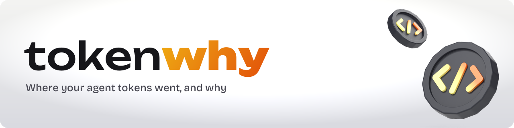
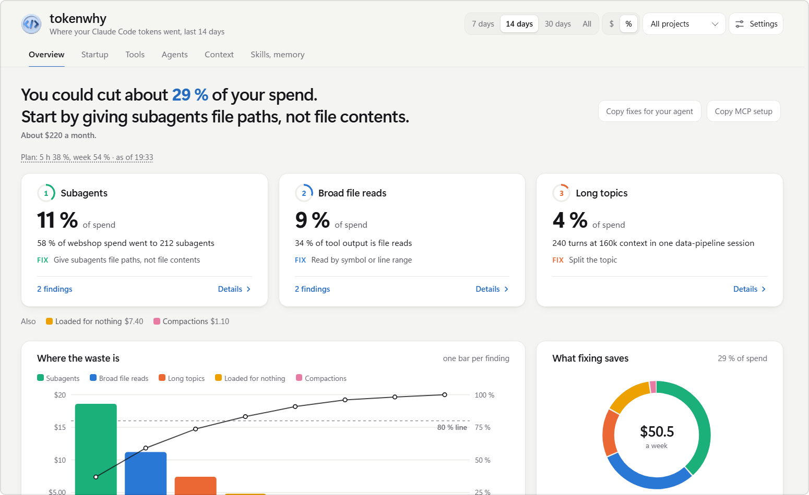
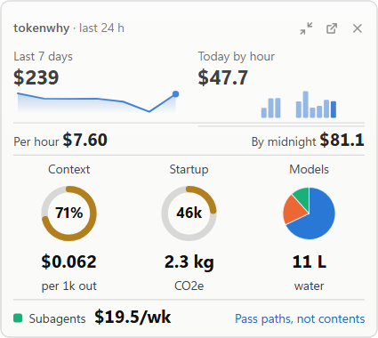
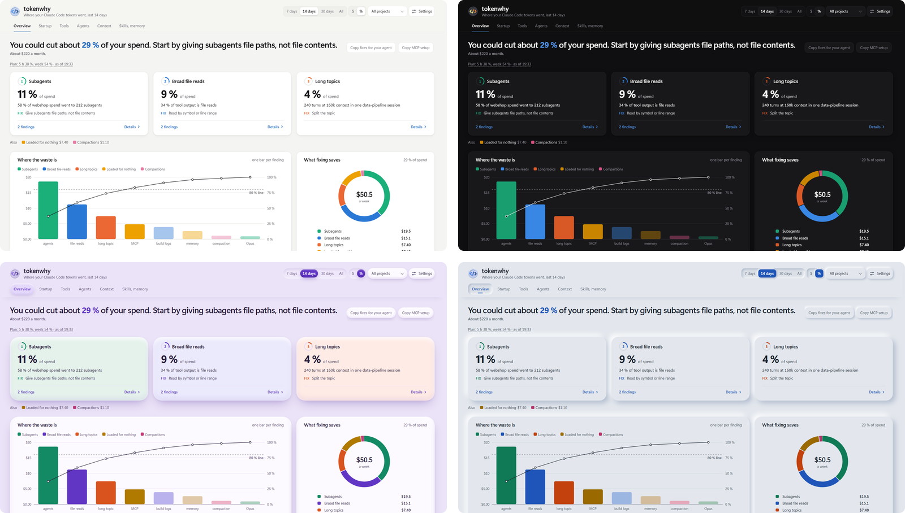

<p align="center">
  <picture>
    <source media="(prefers-color-scheme: dark)" srcset="brand/readme-banner-dark.png">
    
  </picture>
</p>

<p align="center">
  <b>Where your AI coding agent tokens go, and what to change.</b><br>
  Local, read-only. Supports Claude Code, Codex, opencode, Antigravity...
</p>

<p align="center">
  <a href="https://github.com/tokenwhy-app/tokenwhy/releases/latest">Download</a> ·
  <a href="docs/cli.md">CLI and MCP</a> ·
  <a href="docs/advanced.md">Advanced</a> ·
  <a href="LICENSE">Apache-2.0</a>
</p>

<p align="center">
  
</p>

## What it does

**tokenwhy** gives you metrics and figures about the tokens you use :
their footprint, their cost, and what to optimize in order to reduce this impact. Fewer tokens also means faster sessions and a cleaner
context that is more efficient.

- **Footprint:** CO2e and water per week, estimated from published methods (see Credits).
- **What to change first:** Using Pareto law, we prioritize the fixes that have most impact.
- **What loads even before your first message:** Memory, skills, tools and MCP servers...
- **Tracking:** Daily, weekly and monthly aggregated charts.

## Install

Download the Windows installer from [Releases](https://github.com/tokenwhy-app/tokenwhy/releases/latest).
Sorry, it is not code-signed,  so Windows may warn on first launch. You may choose **"More info"**, then **"Run anyway"**.

## Widget

<p align="center">
  
</p>

## Themes

<p align="center">
  
</p>

## Use it with your agent

You can copy the fixes prompt from the Overview panel with 1 click, or let the agent ask tokenwhy autonomously over MCP.

```
claude mcp add --scope user tokenwhy -- <path to>/tokenwhy mcp --anon
```


Every command and the MCP tools are in [docs/cli.md](docs/cli.md).


## Privacy

tokenwhy has no network code and sends nothing anywhere. Any sharing that could be added later will be opt-in
and off by default. It reads your agents' transcript folders and writes only its own cache.

## Contributing

Issues and pull requests are welcome. To build from source:

```
npm ci --prefix app/web
cd app && cargo tauri build          # installer, builds the UI too
cargo build --release -p tokenwhy     # CLI only
```

More information about details, themes and code layout in [docs/advanced.md](docs/advanced.md).

## Credits

Some parsing rules and finding ideas come from [codeburn](https://github.com/getagentseal/codeburn) (MIT),
rewritten in Rust. CO2 estimates use [EcoLogits](https://ecologits.ai) (MPL-2.0). Full credits in
[NOTICE](NOTICE), dependency licences in [THIRD_PARTY_LICENSES.txt](THIRD_PARTY_LICENSES.txt).

## License

Apache-2.0. See [LICENSE](LICENSE). Contact: tokenwhy@dryaides.com
